# Pipeline map

<!-- Generated by `pixi run pipeline-graph` from the stage registry
     (pipeline/src/camsocs_pipeline/stages/__init__.py) and the source manifest
     (pipeline/src/camsocs_pipeline/campuses/cam_sources.json).
     Do not edit by hand: tests/test_graph_export.py fails when it is stale. -->

Campus **Cambridge** (`cam`, https://camsocs.uk).
The same graph as data: `webapp/lib/generated/pipeline-graph.cam.json`
(schema `camsocs.pipeline-graph/1`). Lanes are campus × pillar; `engine` stages run
for every campus. Solid arrows write, dotted arrows read, thick arrows post to
Convex.

```mermaid
flowchart LR
  subgraph lane_cam_societies["cam/societies"]
    direction TB
    stage_su_directory["su_directory · harvest"]
    stage_proctors_register["proctors_register · harvest"]
    stage_sport_clubs["sport_clubs · harvest"]
    stage_sport_guide_pdf["sport_guide_pdf · harvest"]
    stage_camdram_societies["camdram_societies · harvest"]
    stage_cucbc_clubs["cucbc_clubs · harvest"]
    stage_colleges["colleges · harvest"]
  end
  subgraph lane_cam_events["cam/events"]
    direction TB
    stage_camdram_events["camdram_events · events"]
    stage_talks_cam["talks.cam lists (G1) · events"]
    stage_cucbc_events["cucbc_events · events"]
    stage_playwaze["playwaze · events"]
    stage_uni_events["uni_events · events"]
    stage_su_whatson["su_whatson · events"]
  end
  subgraph lane_cam_talks["cam/talks"]
    direction TB
    stage_talks["talks · talks"]
  end
  subgraph lane_engine_societies["engine/societies"]
    direction TB
    stage_resolve["resolve · resolve"]
    stage_enrich["enrich · enrich"]
    stage_classify["classify · classify"]
  end
  subgraph lane_engine_events["engine/events"]
    direction TB
    stage_calendar_feeds["calendar_feeds · events"]
    stage_website_events["website_events · events"]
    stage_inbox["inbox · inbox"]
    stage_instagram["instagram · inbox"]
    stage_termcards["termcards · inbox"]
  end
  subgraph lane_engine_shared["engine/shared"]
    direction TB
    stage_term_dates["term_dates · seed"]
    stage_load["load · load"]
    stage_report["report · report"]
  end
  subgraph staging["staging"]
    dir_su_directory[("su_directory")]
    dir_su_profile[("su_profile")]
    dir_proctors_register[("proctors_register")]
    dir_sport_az[("sport_az")]
    dir_sport_club_page[("sport_club_page")]
    dir_sport_guide_pdf[("sport_guide_pdf")]
    dir_camdram[("camdram")]
    dir_cucbc[("cucbc")]
    dir_college_list[("college_list")]
    dir_society_website[("society_website")]
    dir__resolved[("_resolved")]
    dir_linktree[("linktree")]
    dir_camdram__events[("camdram.events")]
    dir_talks_list__events[("talks_list.events")]
    dir_cucbc__events[("cucbc.events")]
    dir_playwaze__events[("playwaze.events")]
    dir_uni_events_api__events[("uni_events_api.events")]
    dir_ics_feed__events[("ics_feed.events")]
    dir_luma__events[("luma.events")]
    dir_su_whatson__events[("su_whatson.events")]
    dir_society_website__events[("society_website.events")]
    dir_mailing_list_email[("mailing_list_email")]
    dir_instagram_api[("instagram_api")]
    dir_termcard[("termcard")]
    dir_talks[("talks")]
  end
  sel_org_lookup{{"@org_lookup"}}
  sel_event_index{{"@event_index"}}
  sel_all_observations{{"@all_observations"}}
  subgraph convex["Convex /api/pipeline"]
    sink_termDates[/"termDates"/]
    sink_crosswalk[/"crosswalk"/]
    sink_inbound_pending[/"inbound/pending"/]
    sink_inbound_file[/"inbound/file"/]
    sink_suppressions[/"suppressions"/]
    sink_sources[/"sources"/]
    sink_files[/"files"/]
    sink_claims[/"claims"/]
    sink_orgInternal[/"orgInternal"/]
    sink_relationships[/"relationships"/]
    sink_eventOrganisers[/"eventOrganisers"/]
    sink_events_superseded[/"events/superseded"/]
    sink_brokerInferences[/"brokerInferences"/]
    sink_inbound_mark[/"inbound/mark"/]
    sink_talks_departments[/"talks/departments"/]
    sink_talks_batch[/"talks/batch"/]
    sink_talks_sweep[/"talks/sweep"/]
    sink_talks_runs[/"talks/runs"/]
    sink_coverage[/"coverage"/]
    sink_coverage_events[/"coverage/events"/]
  end
  stage_term_dates ==> sink_termDates
  stage_su_directory --> dir_su_directory
  stage_su_directory --> dir_su_profile
  stage_proctors_register --> dir_proctors_register
  stage_sport_clubs --> dir_sport_az
  stage_sport_clubs --> dir_sport_club_page
  dir_sport_club_page -.-> stage_sport_guide_pdf
  stage_sport_guide_pdf --> dir_sport_guide_pdf
  stage_camdram_societies --> dir_camdram
  stage_cucbc_clubs --> dir_cucbc
  stage_colleges --> dir_college_list
  stage_colleges --> dir_society_website
  sel_all_observations -.-> stage_resolve
  stage_resolve --> dir__resolved
  sink_crosswalk -.-> stage_resolve
  dir__resolved -.-> stage_enrich
  stage_enrich --> dir_society_website
  stage_enrich --> dir_linktree
  sel_all_observations -.-> stage_classify
  stage_classify --> sel_all_observations
  sel_org_lookup -.-> stage_camdram_events
  stage_camdram_events --> dir_camdram__events
  sink_crosswalk -.-> stage_camdram_events
  sel_org_lookup -.-> stage_talks_cam
  stage_talks_cam --> dir_talks_list__events
  sink_crosswalk -.-> stage_talks_cam
  sel_org_lookup -.-> stage_cucbc_events
  stage_cucbc_events --> dir_cucbc__events
  sink_crosswalk -.-> stage_cucbc_events
  sel_org_lookup -.-> stage_playwaze
  stage_playwaze --> dir_playwaze__events
  sink_crosswalk -.-> stage_playwaze
  sel_org_lookup -.-> stage_uni_events
  stage_uni_events --> dir_uni_events_api__events
  sink_crosswalk -.-> stage_uni_events
  sel_org_lookup -.-> stage_calendar_feeds
  stage_calendar_feeds --> dir_ics_feed__events
  stage_calendar_feeds --> dir_luma__events
  sink_crosswalk -.-> stage_calendar_feeds
  dir_su_profile -.-> stage_su_whatson
  sel_org_lookup -.-> stage_su_whatson
  stage_su_whatson --> dir_su_whatson__events
  sink_crosswalk -.-> stage_su_whatson
  dir_society_website -.-> stage_website_events
  stage_website_events --> dir_society_website__events
  sel_org_lookup -.-> stage_inbox
  sel_event_index -.-> stage_inbox
  stage_inbox --> dir_mailing_list_email
  sink_crosswalk -.-> stage_inbox
  sink_inbound_pending -.-> stage_inbox
  sink_inbound_file -.-> stage_inbox
  sink_suppressions -.-> stage_inbox
  stage_inbox ==> sink_sources
  stage_inbox ==> sink_files
  stage_inbox ==> sink_claims
  stage_inbox ==> sink_orgInternal
  stage_inbox ==> sink_relationships
  stage_inbox ==> sink_eventOrganisers
  stage_inbox ==> sink_events_superseded
  stage_inbox ==> sink_brokerInferences
  stage_inbox ==> sink_inbound_mark
  sel_org_lookup -.-> stage_instagram
  sel_event_index -.-> stage_instagram
  stage_instagram --> dir_instagram_api
  sink_crosswalk -.-> stage_instagram
  stage_instagram ==> sink_files
  sel_org_lookup -.-> stage_termcards
  sel_event_index -.-> stage_termcards
  stage_termcards --> dir_termcard
  sink_crosswalk -.-> stage_termcards
  stage_resolve -. requires .-> stage_load
  sel_all_observations -.-> stage_load
  sink_suppressions -.-> stage_load
  stage_load ==> sink_sources
  stage_load ==> sink_files
  stage_load ==> sink_claims
  stage_load ==> sink_orgInternal
  stage_load ==> sink_relationships
  stage_load ==> sink_eventOrganisers
  stage_load ==> sink_events_superseded
  stage_load ==> sink_brokerInferences
  stage_talks --> dir_talks
  stage_talks ==> sink_talks_departments
  stage_talks ==> sink_talks_batch
  stage_talks ==> sink_talks_sweep
  stage_talks ==> sink_talks_runs
  sink_coverage -.-> stage_report
  sink_coverage_events -.-> stage_report
```

## Stages

| # | Stage | Phase | Pillar | Lane | Groups | Network | LLM | Docs |
|---|---|---|---|---|---|---|---|---|
| 0 | `term_dates` | seed | shared | engine/shared | events, full | no | no | [§19](source-research.md#19-university-full-term-dates) |
| 1 | `su_directory` | harvest | societies | cam/societies | full | yes | no | [§1](source-research.md#1-cambridge-su-find-a-society) |
| 2 | `proctors_register` | harvest | societies | cam/societies | full | yes | no | [§2](source-research.md#2-proctors-register) |
| 3 | `sport_clubs` | harvest | societies | cam/societies | full | yes | no | [§3](source-research.md#3-sport-cambridge-az-and-club-pages) |
| 4 | `sport_guide_pdf` | harvest | societies | cam/societies | full | yes | no | [§4](source-research.md#4-sports-club-guide-2026-27-pdf) |
| 5 | `camdram_societies` | harvest | societies | cam/societies | full | yes | no | [§5](source-research.md#5-camdram) |
| 6 | `cucbc_clubs` | harvest | societies | cam/societies | full | yes | no | [§7](source-research.md#7-cucbc) |
| 7 | `colleges` | harvest | societies | cam/societies | full | yes | no | [§8](source-research.md#8-colleges-and-jcrmcr) |
| 8 | `resolve` | resolve | societies | engine/societies | full | no | no | – |
| 9 | `enrich` | enrich | societies | engine/societies | full | yes | yes | [§13](source-research.md#13-linktree), [§14](source-research.md#14-society-websites) |
| 10 | `classify` | classify | societies | engine/societies | full | yes | yes | – |
| 11 | `camdram_events` | events | events | cam/events | events, full | yes | no | [§5](source-research.md#5-camdram) |
| 12 | `talks_cam` (talks.cam lists (G1)) | events | events | cam/events | events, full | yes | no | [§6](source-research.md#6-talkscam) |
| 13 | `cucbc_events` | events | events | cam/events | events, full | yes | no | [§7](source-research.md#7-cucbc) |
| 14 | `playwaze` | events | events | cam/events | events, full | yes | no | [§9](source-research.md#9-playwaze-college-leagues-and-bucs) |
| 15 | `uni_events` | events | events | cam/events | events, full | yes | no | [§10](source-research.md#10-university-events-programme-read-with-permission) |
| 16 | `calendar_feeds` | events | events | engine/events | events, full | yes | no | [§11](source-research.md#11-calendar-feeds-that-societies-publish) |
| 17 | `su_whatson` | events | events | cam/events | events, full | yes | no | [§12](source-research.md#12-su-whats-on) |
| 18 | `website_events` | events | events | engine/events | events, full | yes | yes | [§14](source-research.md#14-society-websites) |
| 19 | `inbox` | inbox | events | engine/events | events, full | no | yes | [§16](source-research.md#16-mailing-list-inbox), [§20](source-research.md#20-sympa-public-list-search) |
| 20 | `instagram` | inbox | events | engine/events | events, full | yes | yes | [§17](source-research.md#17-meta-instagram-business-discovery) |
| 21 | `termcards` | inbox | events | engine/events | events, full | yes | yes | [§21](source-research.md#21-termcards) |
| 22 | `load` | load | shared | engine/shared | events, full | no | no | – |
| 23 | `talks` | talks | talks | cam/talks | events, full, talks | yes | no | [talks-redesign-spec](talks-redesign-spec.md) |
| 24 | `report` | report | shared | engine/shared | events, full | no | no | – |

## Groups

| Group | Schedule | Stages | Needs | Stale after |
|---|---|---|---|---|
| `events` | daily 04:30 Europe/London | 15 | `_resolved`, `society_website`, `su_profile` | 8 days |
| `full` | weekly Sun 02:00 Europe/London | 25 | – | – |
| `talks` | by hand | 1 | – | – |

## Sources

| Source | Stage | Pillar | Source types | Event sources | § | Permission |
|---|---|---|---|---|---|---|
| University Full Term dates (verified seed) | `term_dates` | shared | – | – | [§19](source-research.md#19-university-full-term-dates) | – |
| Cambridge SU society directory and profiles | `su_directory` | societies | `su_directory`, `su_profile` | – | [§1](source-research.md#1-cambridge-su-find-a-society) | D3 |
| Proctors' register of societies | `proctors_register` | societies | `proctors_register` | – | [§2](source-research.md#2-proctors-register) | robots |
| Sport Cambridge A–Z and club pages | `sport_clubs` | societies | `sport_az`, `sport_club_page` | – | [§3](source-research.md#3-sport-cambridge-az-and-club-pages) | robots |
| Sports Club Guide (PDF) | `sport_guide_pdf` | societies | `sport_guide_pdf` | – | [§4](source-research.md#4-sports-club-guide-2026-27-pdf) | robots |
| Camdram societies | `camdram_societies` | societies | `camdram` | – | [§5](source-research.md#5-camdram) | robots |
| CUCBC clubs | `cucbc_clubs` | societies | `cucbc` | – | [§7](source-research.md#7-cucbc) | D3 |
| College and JCR/MCR society lists | `colleges` | societies | `college_list`, `society_website` | – | [§8](source-research.md#8-colleges-and-jcrmcr) | D3 |
| Linktree pages | `enrich` | societies | `linktree` | – | [§13](source-research.md#13-linktree) | D3 |
| Society websites | `enrich` | societies | `society_website` | – | [§14](source-research.md#14-society-websites) | D3 |
| Camdram diary | `camdram_events` | events | `camdram` | `camdram` | [§5](source-research.md#5-camdram) | robots |
| talks.cam lists (G1) | `talks_cam` | events | `talks_list` | `talks_cam` | [§6](source-research.md#6-talkscam) | robots |
| CUCBC calendar, Bumps and timetable | `cucbc_events` | events | `cucbc` | `cucbc` | [§7](source-research.md#7-cucbc) | robots |
| Playwaze college leagues | `playwaze` | events | `playwaze` | `playwaze` | [§9](source-research.md#9-playwaze-college-leagues-and-bucs) | robots |
| University events programme | `uni_events` | events | `uni_events_api` | `uni_events_api` | [§10](source-research.md#10-university-events-programme-read-with-permission) | D3a |
| Society calendar feeds (ICS, Google Calendar, Luma) | `calendar_feeds` | events | `ics_feed`, `luma` | `ics`, `google_calendar`, `luma` | [§11](source-research.md#11-calendar-feeds-that-societies-publish) | D3 |
| SU What's On | `su_whatson` | events | `su_whatson` | `su_whatson` | [§12](source-research.md#12-su-whats-on) | D3 |
| Society websites' events pages | `website_events` | events | `society_website` | `website`, `termcard` | [§14](source-research.md#14-society-websites) | D3 |
| Forwarded mailing-list mail | `inbox` | events | `mailing_list_email` | `mailing_list` | [§16](source-research.md#16-mailing-list-inbox) | – |
| Instagram Business Discovery API | `instagram` | events | `instagram_api` | `instagram_api` | [§17](source-research.md#17-meta-instagram-business-discovery) | – |
| Termcards | `termcards` | events | `termcard` | `termcard` | [§21](source-research.md#21-termcards) | D3 |
| talks.cam API and department sites (talks pillar) | `talks` | talks | – | – | – | robots |
